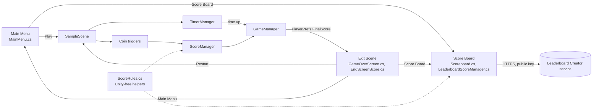

# Football-Platformer

A football-themed 3D platformer built in Unity 2022.3 (C#, Universal Render Pipeline). You run a timed obstacle course collecting coins for points, then submit your score to an online leaderboard.

There is no ASP.NET or other server code in this repo. The "web integration" is the third-party [Leaderboard Creator](https://danqzq.itch.io/leaderboard-creator) client (`FootballGame/Assets/LeaderboardCreator/`), which talks to a hosted service over HTTPS using a public leaderboard key. The only shaders are the stock ones that ship with TextMesh Pro and the bundled asset packs.

## Play

1. Open `FootballGame/` in Unity **2022.3.17f1** (see `FootballGame/ProjectSettings/ProjectVersion.txt`). Packages resolve from `FootballGame/Packages/manifest.json`.
2. Open `Assets/Scenes/Main Menu.unity` and press Play.

Gameplay:
- The timer (`TimerManager`) counts down 180 s in `SampleScene` (the script default is 60 s).
- Each coin (`Coin`, `CustomMoney` prefab) adds 8000 points through `ScoreManager` in `SampleScene` (prefab default 100). The end screen shows the score against a 400000 target.
- When time runs out, `GameManager` saves the score to `PlayerPrefs` and loads **Exit Scene**. From there you can restart, go back to the menu, or open the **Score Board** to submit and view scores.
- The live player is the Starter Assets first-person capsule (`TestPlayer`, tag `Player`). The leftover `BallmanController` disables itself when that player is present.

## Architecture



## Tests / CI

`FootballGame/Assets/Scripts/ScoreRules.cs` has no Unity dependencies, so the xUnit project compiles it directly:

```bash
dotnet test tests/FootballPlatformer.Tests/FootballPlatformer.Tests.csproj
```

GitHub Actions (`.github/workflows/ci.yml`) runs:
- **Tests:** the xUnit suite, with compiler and analyzer warnings treated as errors.
- **Hygiene:** `scripts/check-repo-hygiene.sh`, which rejects tracked player builds and zip dumps.
- **Secrets:** a Gitleaks scan of the full history.

The Unity scripts themselves are not compiled in CI, because that needs a licensed Unity editor.

## Repo layout

```
.
├── FootballGame/            # Unity project (Assets, Packages, ProjectSettings)
│   ├── .gitignore           # official GitHub Unity template
│   └── Assets/
│       ├── Scenes/          # Main Menu, SampleScene, Exit Scene, Score Board
│       ├── Scripts/         # game scripts and ScoreRules
│       ├── LeaderboardCreator/   # third-party leaderboard client
│       └── Assets/          # third-party asset packs (Starter Assets, Obstacle Course Pack, POLYGON city, household items)
├── tests/FootballPlatformer.Tests/  # xUnit tests for ScoreRules
└── scripts/check-repo-hygiene.sh
```

Linux player output (`Dash and Grab_Data/`, `UnityPlayer.so`, zip dumps) is gitignored and must stay untracked.

## Leaderboard key

`Scoreboard.cs` embeds the leaderboard's **public** key, which Leaderboard Creator is designed to ship in game clients. No secret key is committed. As with any client-only leaderboard, scores can be submitted by anyone who has the public key.
